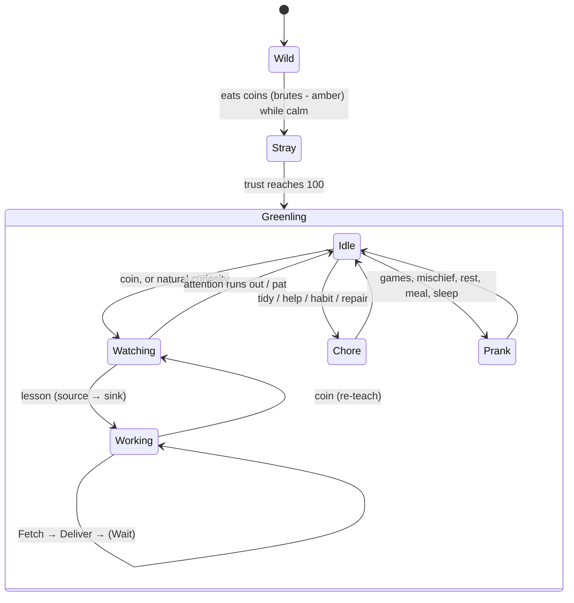

# Architecture

## Ground rules

- **Behaviour via Harmony, state via ZDO.** A networked object's ZDO is its synced state. Only the
  *owner* client runs a creature's AI, so the greenling brain runs on the owner and writes everything that
  matters (state, job, carried item, trust, traits) to `gl_*` ZDO keys. Every client derives its visuals
  from the ZDO.
- **Player actions on other objects go through that object's RPCs** (add ore, use a door, repair), never
  by writing someone else's ZDO.
- **Vanilla first.** `Tameable`, `MonsterAI.MoveTo`, `EffectList`s and vanilla RPCs are reused wherever they
  fit, because other mods already cooperate with those systems.
- **Everyone needs the mod.** Prefab changes happen in `ZNetScene.Awake` on every client and the server.

## The brain

`BrainHook` is a prefix on `MonsterAI.UpdateAI`. For a tamed greenling it runs `GreenlingBrain` instead of
vanilla whenever the greenling has something to do. Vanilla still runs for fighting (when it has a target or is hurt)
and for plain idling.

Overlays that win over any of the states above:

- **Danger** (`Danger.cs`): greylings and hurt greydwarfs flee to a refuge (a player or brute) or panic.
- **Follow** (`gl_follow`): following a player, or tagging along briefly as a stray.
- **Needs**: hunger sends it to food on the ground. Night sends it to a nest bed (`Nest.Assign`).

### Working loop

A **job** is up to 3 **steps** (`LaborTask`: item, source endpoint, sink endpoint). Each trip:

1. `PickStep` takes the first step that has work and somewhere to put it.
2. **Fetch.** Go to the source and take one item. Sources: a container, a ground drop, a pickable area, a break area,
   or a producer (hive, sap collector, cooking station, fermenter).
3. **Deliver.** At the start of the phase `Sinks.Choose` picks the actual target: the chest already holding the item,
   the lowest fire on the same fuel, a machine in the same bank, a ground pile, or the player. Then it puts the item in
   through the target's own RPC.
4. **Wait** with a reason (`no_work`, `nowhere_to_put_it`, `no_path`, ...). A greenling stuck waiting with empty hands
   counts as free, so it goes off to do a chore or play.

Jobs **generalize** by radius: endpoints remember a prefab and a position, and match anything of that kind within
`WorkRadius`. This is also what makes jobs survive a world reload, because ZDOIDs change when a world loads.

## Source files

| File | Responsibility |
|---|---|
| `Plugin.cs` | Entry point, config, per-frame updates |
| `PrefabSetup.cs` | Makes greylings, greydwarfs and brutes tameable (per-role taming items, effects) |
| `Greenling.cs` | Per-instance component: ZDO keys, RPCs, trust, hover status, death drop |
| `GreenlingBrain.cs` | Owner-side state machine, plus `BrainHook` |
| `Teaching.cs` | Teacher-side: turns player actions into demonstrations and lessons |
| `Labor.cs` | `Endpoint`, `LaborTask`, `Sources`, `Sinks`: the task adapters |
| `Roles.cs` | What each role can learn |
| `Chores.cs` | Free-time useful work (tidy, help, habits) and the no-regret rules |
| `Pranks.cs` | Games, mischief, meals, sleep, rest, decorating, repair |
| `Needs.cs`, `Nest.cs` | Hunger, the nest piece, bed assignment |
| `Danger.cs` | Threat detection, refuge and panic, the animal truce |
| `Doors.cs` | Opening and closing doors through the door's RPC |
| `Interaction.cs` | Pat, use item (coin, food, hammer), hover text |
| `Traits.cs`, `Names.cs`, `Mimicry.cs` | Personality |
| `CarryVisual.cs`, `Crown.cs`, `Effects.cs`, `Models.cs`, `GreenlingModel.cs` | Visuals: carried item, head sprout, sparkles, remodel |
| `Breakables.cs` | What can be smashed, and by whom |
| `Fields.cs` | Planting: the field grid (spacing, rows, extent), next spot, placing a crop, the player-planting hook |
| `Shamans.cs` | Healing (patients, cooldown, the prayer effect), strays to soothe, shaman company |
| `Tools.cs` | Which work needs which tool, who can use it, fetching one from a chest |
| `Commands.cs` | `gl_dump`, `gl_prank` |

## Synced state (ZDO keys)

| Key | Meaning |
|---|---|
| `gl_state` | Idle / Watching / Working / ... |
| `gl_task` | The job: steps separated by newlines |
| `gl_teacher`, `gl_attention`, `gl_casual`, `gl_attentive` | Lesson in progress |
| `gl_habits` | No-regret chores picked up by watching |
| `gl_carry_item`, `gl_carry_n` | What it's carrying (drives the hand visual) |
| `gl_bond`, `gl_last_pat`, `gl_last_fed` | Trust and its cooldowns |
| `gl_traits` | Personality |
| `gl_follow`, `gl_follow_until` | Who it follows, and until when (strays tagging along) |
| `gl_scared` | Frightened until |
| `gl_tool` | Tool held (Hammer, Cultivator) |
| `gl_last_soothe` | When a shaman last soothed this stray |

## Notable patches

| Patch | Why |
|---|---|
| `MonsterAI.UpdateAI` prefix (`BrainHook`) | Hands control to the brain |
| `MonsterAI.UpdateTarget` postfix | Greenlings never target animals |
| `BaseAI.IsEnemy` postfix | Tamed creatures count as enemies of every wild creature, so this truce stops boars and greenlings attacking each other unprovoked |
| `RandomFlyingBird.DangerNearby` postfix | Birds take off when a greenling chases them |
| `Tameable.IsHungry` | Strays only want food when they aren't full |
| `Character.OnDeath` prefix | Drops the carried item and the hammer |
| `Humanoid.DropItem` | Dropping an item while watched teaches a ground (feeding spot) sink |
| `Player.PlacePiece` postfix (`PlantHook`) | Planting a crop while watched teaches a field sink |

!!! warning "Harmony gotcha"
    `PatchAll` only finds classes that have a class-level `[HarmonyPatch]` attribute. A class with only
    method-level attributes is silently skipped. That's why the nest piece once never registered.
